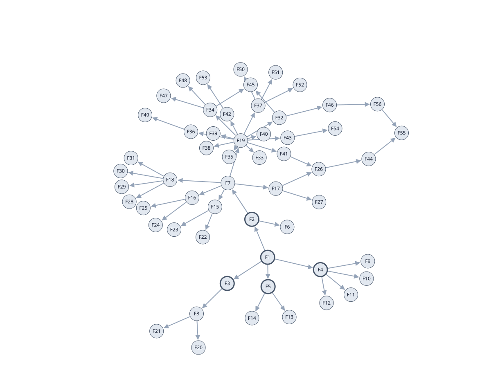

<a href="https://lampata.co.uk"></a>

# OGC application-package generator
`Note: this is still under development`

Generate an OGC CWL application package and job YAML from a public GitHub Python repository.

Grounding generation in source code and resource I/O makes proposed application packages easier to check. The aim is also to explore smaller local models that can use the same evidence and validation loop.

Static analysis builds a function graph; an LLM labels clusters and infers resource I/O; validation guides repairs. The repository must already expose reusable commands and have a container image.


The approach was originally researched and developed during Lampata’s contribution to OSPD 2025, exploring AI for scientific product and workflow packaging across several examples. This work continues through Lampata’s OSPD 2026 contribution. Full details of the original key ideas are in the [Lampata annex of the OSPD25 report](http://ospd-2025-2cf271.pages.ogc.org/documents/D010/document.html#annex-lampata).

Use the Pixi environment (currently Apple Silicon macOS) and configure LLM credentials in your environment or `.env`. Optional: `GITHUB_TOKEN` (or `GH_TOKEN`).

```python
from generate import generate

cwl, job = generate(
    repo_url="https://github.com/your-org/your-repo",
    container_image="ghcr.io/your-org/your-image:tag",
    extra_docs="Optional workflow context, example input paths and small-run settings.",
)
```



Defaults: clustering threshold `4.0`, separate entrypoints, five candidate attempts and required graph checks. Override `model`, `distance_threshold`, `separate_entrypoints`, `max_attempts`, `require_graph`, `entrypoints` or `env_file` as needed. Returns two strings; saving and workflow execution are separate.

The [notebook](generate.ipynb) explains the pipeline using [Lightning2EarthCARE](https://github.com/sunnydean/lightning2earthcare/tree/main) as a worked example. The saved graphs show its functions and labelled clusters. Grey arrows show code connections; dashed orange arrows show inferred artifact dependencies.

**Development note:** This iteration uses Gemini via Google's REST API and Python's standard-library HTTP client. Set `GEMINI_API_KEY` (or `GOOGLE_API_KEY`); `GEMINI_MODEL` defaults to `gemini-flash-latest`.
